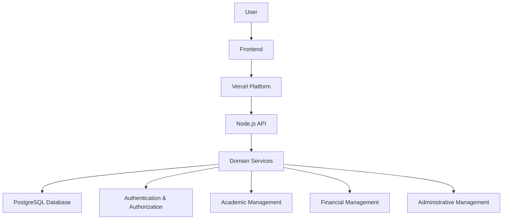

# EduGest — School Management Platform

**A web-based platform for academic, administrative and financial school management.**

EduGest is a school management platform designed to centralize institutional operations, organize academic information and simplify administrative workflows.

The system brings together different areas of school management in a unified environment, providing tools for managing students, teachers, classes, academic records, payments and institutional information.

> **Project Status:** Private product — Public technical showcase.

---

## Overview

Managing a school involves coordinating multiple processes, from student enrollment and academic records to financial operations and institutional communication.

EduGest was developed to address these operational needs through a centralized web application.

Rather than treating each administrative activity as an isolated process, the platform organizes multiple school management domains within a single system.

## Key Features

### Academic Management
- Student registration and management.
- Class and course organization.
- Subject management.
- Academic records and grades.
- Teacher management.

### Administrative Management
- Employee management.
- User administration and access roles.
- School configuration.
- Invitation-based user registration.
- Institutional announcements and communication.

### Financial Management
- Tuition fee management.
- Payment registration.
- Cash flow management.
- Financial information and operational tracking.

### Reporting and Data Management
- Dashboard with operational indicators.
- Data import and export capabilities.
- Spreadsheet and PDF document generation.
- Backup and data management utilities.

---

## Technology Stack

| Layer | Technologies |
|---|---|
| Frontend | HTML5, CSS3, JavaScript |
| Backend | Node.js |
| API Deployment | Vercel Serverless Functions |
| Database | PostgreSQL |
| Authentication | JWT, bcryptjs |
| Database Integration | PostgreSQL (`pg`), Supabase JS in selected frontend modules |
| Data Export | XLSX, jsPDF |
| Deployment | Vercel |

---

## Architecture

EduGest follows a modular monolithic architecture.

The backend centralizes HTTP request handling and separates business operations into domain-oriented service modules.



This structure keeps the application organized while avoiding the operational complexity of a distributed microservices architecture.

For a more detailed explanation, see [System Architecture](diagrams/system-architecture.md).

---

## Project Structure

The application is organized around frontend pages, backend API routes and domain-oriented services.

```text
EduGest/
├── api/
│   ├── index.js
│   └── ...
│
├── services/
│   ├── estudantes.js
│   ├── professores.js
│   ├── turmas.js
│   ├── propinas.js
│   ├── caixa.js
│   └── ...
│
├── public/
│   ├── dashboard.html
│   ├── estudantes.html
│   ├── turmas.html
│   ├── pagamento.html
│   ├── ...
│   ├── scripts/
│   ├── styles/
│   └── assets/
│
├── libs/
├── vercel.json
└── package.json
```

*This structure represents the main organizational areas of the private application.*

---

## Engineering Decisions

Several architectural decisions shaped the development of EduGest:

- **Modular monolith:** Keeps business domains organized without unnecessary distributed-system complexity.
- **PostgreSQL:** Provides a relational foundation for interconnected academic, administrative and financial data.
- **Vercel Serverless Functions:** Supports API deployment without maintaining a dedicated application server.
- **Native frontend technologies:** HTML, CSS and JavaScript provide direct control over the interface and application behavior.
- **Domain-oriented services:** Separates business operations into modules that are easier to understand and maintain.

More details are available in [Engineering Decisions](docs/engineering-decisions.md).

---

## Technical Documentation

Explore the technical documentation:

- [System Architecture](docs/architecture.md)
- [Technical Overview](docs/technical-overview.md)
- [Features and Modules](docs/features.md)
- [Engineering Decisions](docs/engineering-decisions.md)
- [System Architecture Diagram](diagrams/system-architecture.md)
- [Request Flow Diagram](diagrams/request-flow.md)

---

## Screenshots

Screenshots of the application interface will be added after preparing sanitized images that do not expose real student information, institutional records or sensitive operational data.

---

## Development

**Developer:** Emanuel Gonçalves

EduGest was independently designed and developed as a practical software engineering project, involving frontend development, backend architecture, database integration and the implementation of multiple business domains.

The project provided hands-on experience in building and organizing a complete web-based management platform.

---

## Security and Privacy

EduGest is a private product.

The original source code, production credentials, database configuration and institutional data are not publicly available.

This repository exists exclusively to document the product, its architecture, technical decisions and selected development information.

No real student records, institutional credentials or sensitive production data should be published here.

---

## About This Repository

This repository is a technical showcase, not a runnable distribution of EduGest.

Its purpose is to demonstrate the engineering work behind the platform while preserving the confidentiality and integrity of the original application.

**Built with a focus on practical software engineering, maintainability and real-world operational needs.**