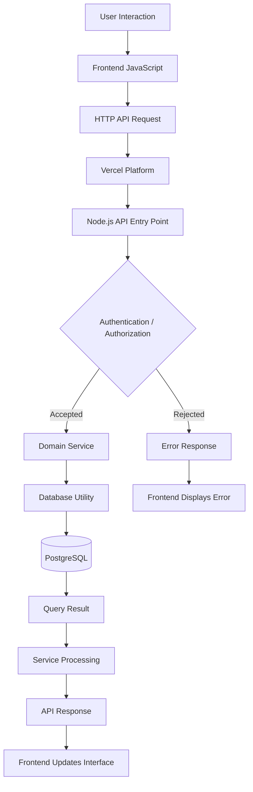

# EduGest — API Request Flow

## Overview

This diagram illustrates a simplified request lifecycle in EduGest.

It follows a typical operation in which a user requests information from the application and the backend processes the request before returning a response.

## Request Lifecycle

## Flow Description

### 1. User Interaction

The user performs an operation through an application page, such as requesting the student list.

### 2. Frontend Processing

JavaScript handles the interaction and prepares an HTTP request for the appropriate API endpoint.

### 3. API Request

The request is sent to the deployed application through Vercel.

### 4. Backend Request Handling

The Node.js API entry point receives the request and coordinates its processing.

### 5. Authentication and Authorization

The backend performs the relevant identity and permission checks before allowing access to protected operations.

### 6. Domain Service Execution

The appropriate service module handles the business operation.

For example, a student-related operation may be handled by the student management service.

### 7. Database Interaction

The backend uses the shared database utility and PostgreSQL client to execute the required database operation.

### 8. Response Processing

The service processes the returned information and the API prepares an HTTP response.

### 9. Frontend Update

The frontend receives the response and updates the interface or displays an appropriate error message.

---

## Important Note

This diagram represents a simplified logical request flow.

The exact sequence of operations, authentication checks and database interactions may differ depending on the endpoint and its implementation.
