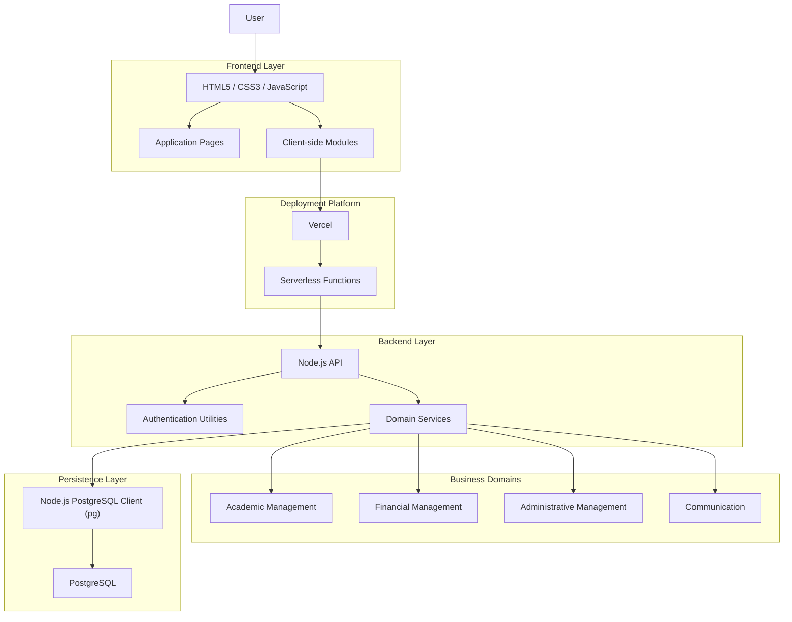

# EduGest — System Architecture Diagram

## Overview

This diagram represents the high-level architecture of EduGest, showing the relationship between the frontend, deployment platform, backend API, domain services and PostgreSQL database.

## Architecture

## Architectural Characteristics

- Modular monolithic backend.
- Native frontend technologies.
- Centralized API request handling.
- Domain-oriented business services.
- PostgreSQL relational persistence.
- Serverless backend deployment through Vercel.

**Note:** The business domains represent functional responsibilities rather than independently deployed services.