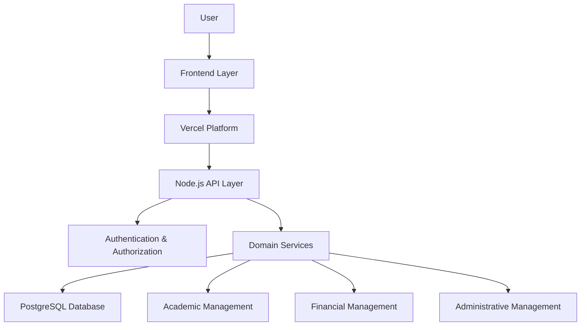
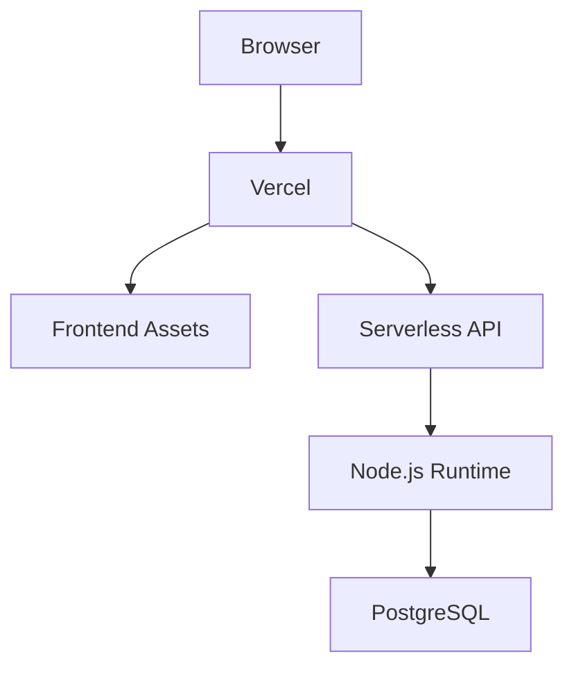

# EduGest — System Architecture

## 1. Architectural Overview

EduGest follows a **modular monolithic architecture**, organizing the application into distinct layers with specific responsibilities.

The system combines a browser-based frontend, a Node.js backend deployed through Vercel Serverless Functions, domain-oriented service modules and a PostgreSQL relational database.

The architecture was designed to centralize school operations while keeping the codebase organized and maintainable.

### High-Level Architecture

---

## 2. Frontend Layer

The frontend is built using native web technologies:

- HTML5 for page structure.
- CSS3 for styling and responsive layouts.
- JavaScript ES Modules for application behavior and modular code organization.

The application provides separate interfaces for different operational areas, including student management, academic administration, financial operations and dashboards.

Frontend modules communicate with backend API endpoints to perform application operations.

**Responsibilities:**
- Render application interfaces.
- Handle user interactions.
- Manage client-side application behavior.
- Send requests to backend endpoints.
- Display operational data and feedback.

The frontend is organized around individual pages and reusable scripts, styles and utility modules.

---

## 3. Backend Layer

The backend runs on Node.js and is deployed through Vercel Serverless Functions.

The API entry point centralizes HTTP request handling and routes requests to the appropriate business operations.

**Responsibilities:**
- Process incoming API requests.
- Validate request data.
- Apply authentication and authorization checks.
- Coordinate business operations.
- Interact with the persistence layer.
- Return structured responses to the frontend.

The backend acts as the boundary between the client application and the database.

---

## 4. Domain Services

Business operations are organized into domain-oriented service modules.

Instead of placing all business logic inside a single API handler, the application separates operations according to their responsibilities.

Examples include:

| Service | Responsibility |
|---|---|
| `estudantes.js` | Student management |
| `professores.js` | Teacher management |
| `turmas.js` | Class management |
| `cursos.js` | Course management |
| `disciplinas.js` | Subject management |
| `notas.js` | Academic records |
| `propinas.js` | Tuition fee operations |
| `caixa.js` | Cash management |
| `usuarios.js` | User management |
| `escolas.js` | School management |

This organization makes the business logic easier to locate, understand and maintain.

---

## 5. Persistence Layer

PostgreSQL is the primary relational database used by EduGest.

The database stores information related to the application's operational domains, including students, teachers, classes, financial records and institutional configuration.

The backend uses the Node.js PostgreSQL client (`pg`) to communicate with the database.

Database connectivity is centralized through a shared database utility.

**Responsibilities:**
- Execute database queries.
- Persist application records.
- Retrieve information for business operations.
- Support relational data management.
- Provide the foundation for transactional operations where required.

Database access is handled by the backend rather than exposing production database credentials to the browser.

---

## 6. Authentication and Authorization

EduGest includes authentication utilities and role-based access concepts.

The authentication layer is responsible for identifying users and supporting access restrictions across protected application operations.

Authorization must be enforced at the backend level, ensuring that access decisions are not based solely on frontend visibility or client-provided information.

**Important security consideration:**

The authentication and authorization implementation requires further hardening and endpoint-level verification before making claims about complete protection or tenant isolation.

---

## 7. Deployment Architecture

The application uses Vercel as its deployment platform.

The frontend is served as a web application, while backend API operations are executed through serverless functions.

This deployment model reduces the need to maintain a dedicated application server.

However, serverless environments require attention to database connection pooling, execution limits and runtime behavior.

---

## 8. Architectural Characteristics

The current architecture has the following characteristics:

| Characteristic | Description |
|---|---|
| Architecture style | Modular monolith |
| Frontend | Native web technologies |
| Backend | Node.js |
| API deployment | Vercel Serverless Functions |
| Database | PostgreSQL |
| Business organization | Domain-oriented services |
| Communication | HTTP API requests |
| Persistence | Relational database |

---

## 9. Current Limitations and Future Improvements

The architecture provides a practical foundation for a multi-domain school management platform. Nevertheless, several areas deserve further engineering attention.

Potential improvements include:

- Stronger separation between routing, business logic and database access.
- Automated integration and authorization tests.
- Consistent request validation.
- Improved database connection management.
- Structured logging and application monitoring.
- More explicit tenant isolation guarantees.
- Centralized error handling.

These improvements would strengthen maintainability, reliability and security as the platform evolves.

---

## Conclusion

EduGest uses a modular monolithic architecture to bring academic, administrative and financial operations into a unified application.

The combination of native frontend technologies, Node.js, Vercel Serverless Functions and PostgreSQL provides a straightforward foundation for organizing and extending the platform.

The architectural approach prioritizes clear responsibilities and manageable complexity over unnecessary infrastructure distribution.