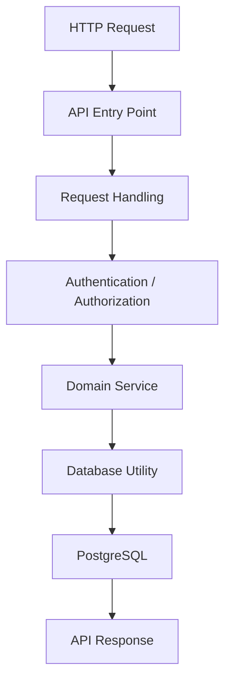

# EduGest — Technical Overview

## 1. Introduction

EduGest is a web-based school management platform developed using native frontend technologies, Node.js and PostgreSQL.

The application combines multiple operational domains within a single system, providing a centralized environment for academic, administrative and financial management.

This document presents the technical components, implementation structure and development technologies behind the platform.

---

## 2. Technology Stack

### Frontend

| Technology | Purpose |
|---|---|
| HTML5 | Page structure |
| CSS3 | Styling and responsive layouts |
| JavaScript ES Modules | Client-side application logic |
| Chart.js | Data visualization |
| XLSX | Spreadsheet operations |
| jsPDF | PDF generation |

### Backend

| Technology | Purpose |
|---|---|
| Node.js | Backend runtime |
| JavaScript ES Modules | Backend module organization |
| Vercel Functions | Serverless API execution |
| PostgreSQL | Relational database |
| pg | PostgreSQL client |
| jose | JWT-related operations |
| bcryptjs | Password hashing utilities |

### Infrastructure

| Component | Technology |
|---|---|
| Application deployment | Vercel |
| API execution | Vercel Serverless Functions |
| Database | PostgreSQL |
| Runtime configuration | Environment variables |

---

## 3. Application Structure

The codebase is organized into several directories, each serving a different purpose.

```text
EduGest/
│
├── api/
│   ├── index.js
│   ├── _auth.js
│   ├── _db.js
│   └── ...
│
├── services/
│   ├── estudantes.js
│   ├── professores.js
│   ├── turmas.js
│   ├── cursos.js
│   ├── disciplinas.js
│   ├── propinas.js
│   ├── caixa.js
│   └── ...
│
├── public/
│   ├── dashboard.html
│   ├── estudantes.html
│   ├── funcionarios.html
│   ├── turmas.html
│   ├── pagamento.html
│   ├── scripts/
│   ├── styles/
│   ├── assets/
│   └── utils/
│
├── libs/
│
├── vercel.json
├── package.json
└── package-lock.json
```

### Directory Responsibilities

**`api/`**

Contains the backend API entry point and shared utilities responsible for request handling, database access and authentication-related operations.

**`services/`**

Contains domain-oriented modules responsible for application business operations.

**`public/`**

Contains the frontend pages, JavaScript modules, stylesheets, assets and browser utilities.

**`libs/`**

Contains frontend libraries used by the application.

**`vercel.json`**

Defines deployment and routing configuration for the Vercel platform.

---

## 4. Backend Organization

The backend separates HTTP request handling from domain-specific operations.

The API entry point acts as the central request handler, while service modules organize the business operations.

A simplified representation:



This organization helps keep the API entry point focused on request coordination while domain services handle specific operational responsibilities.

---

## 5. Database Integration

PostgreSQL serves as the primary persistence layer.

The backend uses the `pg` package to establish database connectivity and execute SQL operations.

A shared database utility centralizes connection-related functionality.

The database supports interconnected operational domains such as:

- Students and academic records.
- Teachers and employees.
- Classes, courses and subjects.
- Tuition fees and payments.
- School and user management.

The relational model provides a foundation for maintaining consistency across these interconnected records.

---

## 6. Frontend Implementation

The frontend uses HTML, CSS and JavaScript ES Modules.

Rather than depending on a large frontend framework, the application uses browser-native technologies to manage its interfaces and interactions.

Its pages are organized according to the application's functional areas.

Examples include:

- Dashboard.
- Student management.
- Teacher management.
- Class management.
- Financial operations.
- Administrative configuration.

JavaScript modules handle interface behavior and communication with backend endpoints.

---

## 7. Authentication and Security Components

The codebase includes authentication-related utilities and dependencies for token operations and password hashing.

The implementation includes:

- JWT-related functionality.
- Password hashing utilities.
- Session-related operations.
- Role-based access concepts.
- Protected backend operations.

Security remains an important area for continuous improvement.

In particular, server-side identity verification, authorization enforcement and school-level data isolation require careful endpoint-level validation.

---

## 8. Deployment and Runtime

EduGest is deployed through Vercel.

The platform serves the frontend and executes backend API operations through serverless functions.

The backend uses environment-based configuration for sensitive runtime values, including database connectivity.

Important deployment considerations include:

- Secure environment variable management.
- PostgreSQL connection pooling.
- Serverless execution limits.
- API response times.
- Production error handling.

---

## 9. Development Considerations

Several technical considerations are relevant to the maintenance and evolution of EduGest:

### Maintainability
Domain-oriented service modules make business operations easier to locate and modify.

### Scalability
The modular monolithic structure allows new business capabilities to be introduced without immediately requiring a distributed architecture.

### Data Integrity
PostgreSQL provides relational capabilities for managing interconnected school records.

### Security
Authentication, authorization and data isolation must be consistently enforced by backend operations.

### Reliability
Automated testing, structured logging and centralized error handling are important areas for further development.

---

## 10. Technical Summary

EduGest combines:

- Native frontend technologies.
- A Node.js backend.
- Vercel Serverless Functions.
- PostgreSQL relational persistence.
- Domain-oriented service modules.
- Authentication and access-control components.
- Data export and reporting utilities.

The implementation reflects a practical approach to building a complete web-based management platform while keeping its architecture understandable and extensible.